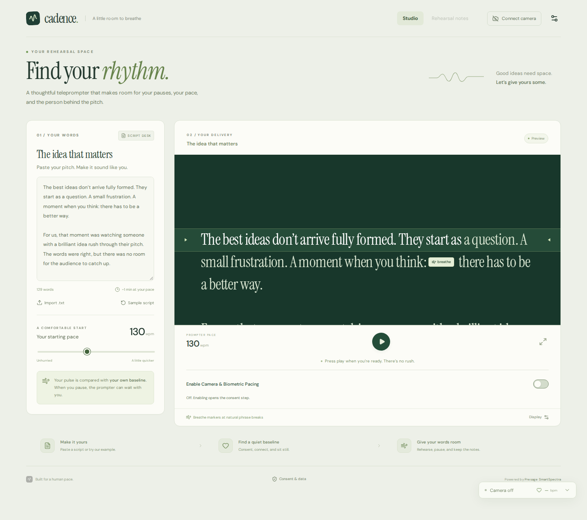

# Cadence

**A little room to breathe.**

Cadence is a rehearsal teleprompter for founders, creators, and speakers. It holds your place during camera-detected speaking pauses, gently slows when a reliable pulse estimate rises above your own quiet baseline, and adds `[ BREATHE ]` markers at natural phrase breaks for your next take.

Built for the [Presage SmartSpectra SDK Challenge](https://dev.to/challenges/presage-2026-11-04). The app runs in a phone or desktop browser; a Linux server runs the native SmartSpectra SDK. A PC is not needed to use the hosted app.

[Open the public studio](https://projected-actual-scotia-nominations.trycloudflare.com/) · [Consent and data handling](docs/PRIVACY.md) · [Demo guide](docs/DEMO.md) · [Submission preparation](docs/SUBMISSION.md)



[Watch the 2:17 simulation walkthrough](public/demo/simulation-walkthrough.mp4). This explains the controls and adaptive behavior; it does not replace the required live-camera submission video.

The public studio offers clearly labeled simulation. For live signals, use a Presage developer key or an operator-provided private rehearsal link. The current preview uses a temporary HTTPS tunnel; its address can change if the tunnel restarts.

## What works

- Paste or import a text script, choose a starting pace, adjust the text size, mirror it, and enter a focused reading view. A dark stage with bright script text and a centered highlight band keeps the reading line clear as the script scrolls.
- Use the **Enable Camera & Biometric Pacing** switch, which starts off and opens the consent step. After accepting phone-camera processing, establish a quiet baseline over at least 35 seconds with stable pulse and breathing estimates. Switching off stops capture; during a rehearsal, it ends the take and opens the review.
- Adapt the scroll rate to reliable pulse changes relative to that baseline. Pause scrolling when stable Presage talking detection shows a speaking pause.
- View SDK-reported BPM, breathing rate, confidence, speaking status, and camera throughput in a collapsible telemetry panel.
- Review the rehearsal, inspect detected pauses, and download a script with suggested and observed `[ BREATHE ]` markers. Exporting rehearsal data is a separate, explicit action.
- Test behavior with simulated BPM **60–140**, breathing rate **8–28**, and speaking/pause controls. Simulation is labeled everywhere and never opens the camera.

**Breathing during speech is a known SDK limitation.** Presage documents that its 30-second breathing rate and breathing waveforms do not work reliably while someone is talking, and breathing confidence remains zero until the full 30-second window is available. A 10-second calibration cannot establish both rates. Cadence uses at least 35 seconds of quiet capture to establish a baseline and suggest phrase breaks. It does not treat a breathing estimate during speech as evidence of a current breathing change. Pulse estimates also average a 12-second window; this is not instant emotion recognition.

## Run locally

Use Linux x64/ARM64 with glibc 2.35 or newer, Windows x64, or Apple Silicon macOS for the server. Node.js **22.12 or newer** is required. The browser can run on another device.

```sh
npm ci
npm run build
npm start
```

Open `http://127.0.0.1:45300`. This loopback address supports browser camera access for a camera on the same computer. To use a phone, publish the server behind **HTTPS with WebSocket support**, then open its secure link on the phone. Plain HTTP on a LAN address is not sufficient for browser camera permission.

`npm ci` installs the SDK's native runtime packages for every supported platform. The download is larger than a typical web app; only the host's runtime is loaded. No C++ build or Electron rebuild is required.

For development, run `npm run dev`. Optional bind settings are documented in [.env.example](.env.example).

## Add a Presage key

1. [Register as a Presage developer](https://physiology.presagetech.com/auth/register) and get a SmartSpectra API key. The challenge uses the normal free trial; additional credits are not included.
2. Select **Enable Camera & Biometric Pacing** to open the consent dialog, then paste the key into the password field. Cadence does not put it in local storage, an export, or a browser bundle.
3. Leave **Include pulse** and **Detect speaking pauses** enabled if your key supports them. If Presage reports a signal authorization error, disable the affected option and reconnect. Pulse is requested individually, without requesting the entire cardio bundle.
4. Read and accept camera processing, then grant the browser's camera permission. Keep the phone still, with a well-lit face and upper chest visible, for the quiet calibration.
5. Press play when the baseline is ready. If only reliable pulse is available after the quiet window, **Continue with pulse only** is available; breathing-based markers then use generic phrase spacing instead of a measured breathing baseline.

Do not paste a real key into source, a `VITE_` environment variable, screenshots, issue comments, or a submission post.

### Private hosted room

An operator can configure an owner key on the server and let its owner use a private link without typing the key on their phone. This configuration is optional; it is not included in this repository or needed for simulation.

Create a private file outside the repository containing:

```dotenv
CADENCE_PRESAGE_API_KEY=your_private_key
CADENCE_ROOM_TOKEN=your_random_private_token
```

Give it mode `600`, use a cryptographically random URL-safe room token of 24–64 characters, and set `CADENCE_CREDENTIALS_FILE` to its absolute path before starting the server. Alternatively, supply the two settings through your service manager's private environment configuration.

The owner opens `https://your-app/#room=their_private_token`. The fragment is removed from the address bar after loading and is not included in the initial HTTP request. The token is sent only in the consented secure WebSocket configuration. The server compares it before supplying the private key to that person's isolated SDK worker. The owner key is never returned to the browser. Other visitors can use their own keys; they cannot use the owner's key without the token. Keep the private room link out of public materials.

## How the integration works

The app separates the teleprompter, camera integration, and pacing rules so the interface can be exercised before connecting a real camera.

| Layer                  | Main files                                               | How to verify it                                                                                                                                           |
| ---------------------- | -------------------------------------------------------- | ---------------------------------------------------------------------------------------------------------------------------------------------------------- |
| Teleprompter interface | `src/App.tsx`, `src/components.tsx`, `src/styles.css`    | Use the labeled simulation to check scrolling, text controls, pause/resume, telemetry, and exports on desktop and phone layouts.                           |
| Camera and native SDK  | `src/camera.ts`, `server/worker.ts`, `shared/metrics.ts` | Run `npm run sdk:check` on the server, then use a consented phone-camera session to check actual signal acquisition.                                       |
| Adaptive pacing        | `shared/engine.ts`                                       | Run `npm test` to check baseline-relative pulse response, signal quality and freshness, speaking-pause holds, and phrase markers independently of the SDK. |

For the hosted version, the phone's browser handles camera access and the VPS runs the official Node.js SDK. Timestamped phone-camera frames enter its custom-input interface, so the server can process them without a physical webcam. The SDK's native runtime is installed through npm; Cadence does not require a hand-written C++ integration. A successful runtime check establishes installation and configuration, while reliable human readings still require a real camera rehearsal.

```text
Phone browser
  consent -> getUserMedia(video only) -> timestamped JPEG camera frames
                       | encrypted WebSocket
                       v
Node server -> isolated worker for this camera session
                 JPEG -> RGB -> SmartSpectraSDK.useCustomInput()
                              -> sendFrame(... PixelFormat.kRGB ...)
                              -> SDK metrics + validation callbacks
                       | normalized readings, confidence and sample ages
                       v
Browser -> quiet baseline -> adaptive pace and speaking-pause holds
        -> rehearsal notes and optional downloads
```

The native SDK is pinned to **3.5.0**. The implementation follows the [official Node.js custom-input API](https://smartspectra.presagetech.com/docs/nodejs) and decodes protobuf packets with `@smartspectra/node-sdk/messages`.

Live requests include chest breathing, breathing rate, and optionally `PULSE_RATE` and `TALKING`. Cadence requests no emotion labels, audio, HRV, blood-pressure diagnosis, or external AI insights. It explicitly sets `enableTelemetry: false`.

Each camera session gets a separate child process because the SDK has process-global native state. That isolates credentials, readings, errors, and teardown across people. Camera frames and decoded metrics are held in memory. On the hosted Linux server, SDK device/model caches go into a per-session temporary directory and are removed after normal worker exit. The frame queue is bounded, the server caps concurrent measurement sessions at two, and a camera session ends after 15 minutes. Closing the connection stops and destroys the SDK worker.

Temporary SDK-cache isolation currently uses Linux's `XDG_CACHE_HOME`. On macOS and Windows the SDK uses its normal platform cache instead; that cache can persist after the camera session. The native measurement API supports those platforms, but use Linux for this application's documented temporary-cache hosting behavior.

## Verification

```sh
npm test
npm run sdk:check
npm run build
npx playwright install chromium
npm run test:e2e
```

Unit checks cover confidence and freshness, supported pulse ranges, source separation, speaking holds, breathing exclusions during speech, marker preservation, private-room authorization, and frame validation. Browser checks cover desktop and phone layouts, consent gating, simulation adaptation, pause holds, exports, and inert script markup.

A separate browser test uses mocked transport and a virtual camera to verify private-link consent, quiet calibration, pulse-based pacing, and camera-track shutdown. Those fixtures are not real physiological readings and are never shipped in the app.

`sdk:check` verifies that the actual native runtime loads and that custom-input configuration and teardown work. It does **not** authenticate or claim physiological readings.

The optional operator probes in `scripts/verify-presage.ts` and `scripts/check-hosted-camera.ts` start the actual SDK with a private key and feed blank frames. They verify startup, validation, secure transport, JPEG decoding, and shutdown. Blank-frame checks do not prove vital-sign accuracy, camera positioning, or a live human demonstration. A real camera rehearsal and real demo video remain necessary for the challenge.

## Practical limits

- **This is presentation practice, not medical or emotional assessment.** A pulse rise can have many causes. Cadence offers a pacing suggestion rather than diagnosing nerves, stress, or health.
- Camera quality, lighting, motion, framing, compression, and network throughput affect measurements. Poor validation, low confidence, stale readings, and unsupported live pulse estimates fall back to the selected manual pace. A sustained low frame rate can end the SDK session; restarting requires a user action.
- Phone-to-server JPEG transport adds compression and network variability. It needs validation on the actual phone and connection. The preview does not make an accuracy claim based on a successful blank-frame or simulation test.
- The app measures camera-based speaking pauses, not an audio transcript or actual spoken words per minute. **Prompter pace** is the chosen/adapted scroll rate. Marker word locations are approximate because they follow the visible script position.
- If speech-pause sensing is disabled or unreliable, pulse-based pacing remains available if pulse is supported. A breathing-only session can establish phrase markers, but offers fewer adaptive controls during speech.
- Leaving the page, moving it into the background, or finishing the rehearsal stops the camera. Script and notes are in page memory; save an export if you want to keep them.

## Credits and license

Cadence's original application code is MIT licensed. Presage SmartSpectra is a separately licensed proprietary dependency, used under [Presage's terms](https://physiology.presagetech.com/tos). It is not relicensed by this project. The official documentation and sample at source revision `90f0cbb4018362ddf5e1a6c3ae2875e92e41861e` informed the integration; this is an independently written application, not a redistributed sample.

DM Sans and Instrument Serif are served locally under the SIL Open Font License; their notices are included in `public/fonts`. Lucide icons, React, and the remaining dependencies retain their respective licenses. See [THIRD_PARTY_NOTICES.md](THIRD_PARTY_NOTICES.md).
